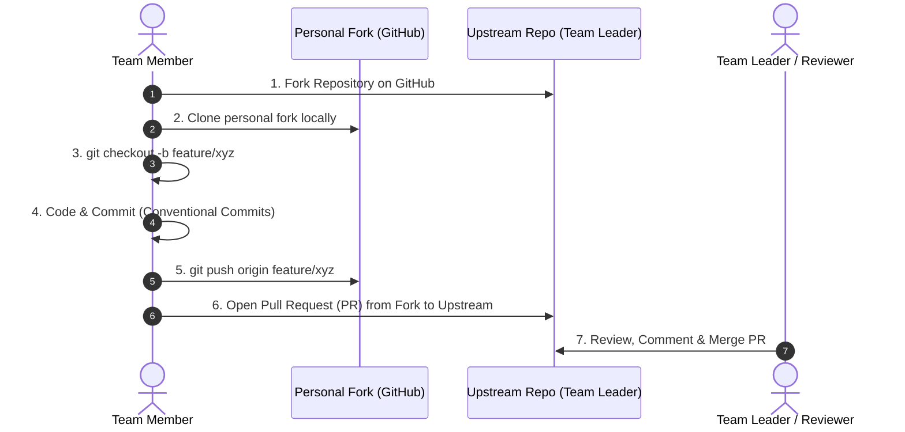

# 🤝 Contributing to CampusSync (Team Git & PR Guide)

Welcome to the **CampusSync** developer community! This repository is designed to help our college lab team collaborate systematically using professional Git & GitHub workflows (Forking, Branching, PRs, and Code Reviews).

---

## 🧭 Team Collaboration Workflow (Step-by-Step)



---

## 🛠️ Step-by-Step Instructions for Team Members

### Step 1: Fork the Repository (GitHub par Fork karein)
1. Go to the main project repository on GitHub.
2. Click the **Fork** button (top-right corner).
3. This creates a copy of the repository in your personal GitHub account (`https://github.com/<your-username>/webDev-Project`).

---

### Step 2: Clone Your Fork to Your Laptop (Local machine par clone karein)
Open Git Bash, PowerShell, or Terminal on your laptop and run:
```bash
# Apne fork ka URL yaha paste karein
git clone https://github.com/<YOUR_GITHUB_USERNAME>/webDev-Project.git

# Project folder ke andar jayein
cd webDev-Project
```

---

### Step 3: Configure Upstream Remote (Main repo se sync rakhne ke liye)
Original repository ko `upstream` ke naam se add karein:
```bash
git remote add upstream https://github.com/<ORIGINAL_OWNER>/webDev-Project.git

# Verify remote URLs
git remote -v
```

---

### Step 4: Install Dependencies & Run Project Locally
Root folder mein dono frontend aur backend dependencies install karein:
```bash
# Root scripts run karein
npm run install:all

# Development server start karein (Backend on 5000 + Frontend on 5173)
npm run dev
```
Ab browser mein `http://localhost:5173` kholein.

---

### Step 5: Create a New Feature Branch (Naye feature ke liye branch banayein)
**⚠️ IMPORTANT:** Kabhi bhi direct `main` branch par code na karein! Hamesha ek new feature branch banayein:
```bash
# Main branch par jayein aur latest updates lein
git checkout main
git pull upstream main

# Apne feature ke naam ki branch banayein (e.g. feature/qr-ticket)
git checkout -b feature/your-feature-name
```
Branch naming conventions:
- `feature/<name>` : Naya feature add karne ke liye (e.g. `feature/qr-ticket`, `feature/email-alerts`)
- `fix/<name>` : Koi bug theek karne ke liye (e.g. `fix/login-error`)
- `docs/<name>` : Documentation update karne ke liye

---

### Step 6: Make Changes & Commit (Clean Commit Messages)
Apne files mein changes karein aur check karein:
```bash
git status
```
Changes ko stage aur commit karein using **Conventional Commits**:
```bash
git add .
git commit -m "feat: add QR code generation for event tickets"
```

Common commit prefixes:
- `feat:` Naya feature
- `fix:` Bug fix
- `docs:` Documentation change
- `style:` Formatting, CSS tweaks, UI styling
- `refactor:` Code cleanup without changing logic

---

### Step 7: Push to Your Fork
```bash
git push -u origin feature/your-feature-name
```

---

### Step 8: Open a Pull Request (PR Create Karein)
1. Apne GitHub account par fork kholein.
2. Waha upar ek banner dikhai dega: **"Compare & pull request"**. Uspar click karein.
3. Base repository: `main` (Team Leader's repo), Head repository: `feature/your-feature-name` (Aapka fork).
4. Pull Request template ko fill karein:
   - Kya changes kiye?
   - Screenshots ya test proof add karein.
   - Related issue number mention karein (`Closes #1`).
5. Click **"Create Pull Request"**.

---

### Step 9: Code Review & Merging
- Team Leader ya peers aapke code ko review karenge.
- Agar koi suggestions ya changes maange jayein, toh apni usi branch par change karke dobara `git commit` aur `git push` karein (PR automatically update ho jayegi).
- Once approved, Team Leader PR ko `main` branch mein merge kar denge! 🎉

---

## 🔄 Keeping Your Fork Updated (Merge Conflicts Se Bachne Ke Liye)
Har naye feature par kaam shuru karne se pehle apni local `main` branch ko upstream se update karein:
```bash
git checkout main
git pull upstream main
git push origin main
```
Agar aap feature branch par hain aur main mein updates aaye hain:
```bash
git checkout feature/your-feature-name
git merge main
```
