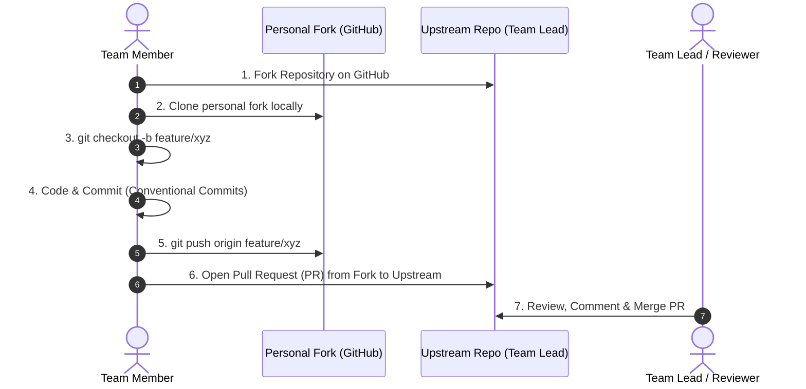

# 🤝 Contributing to VAMS (Team Git & PR Guide)

Welcome to the **VAMS — Smart Event Management Platform** developer repository! This project follows a structured Git & GitHub workflow (Forking, Feature Branches, Conventional Commits, and Pull Requests) for seamless team collaboration.

---

## 🧭 Team Collaboration Workflow



---

## 🛠️ Step-by-Step Instructions for Contributors

### Step 1: Fork the Repository
1. Navigate to the main project repository (`[https://github.com/Madhur-7568/WebDev-Project](https://github.com/Madhur-7568/WebDev-Project)`).
2. Click the **Fork** button in the top-right corner to create a copy under your GitHub account (`[https://github.com/](https://github.com/)<your-username>/WebDev-Project`).

### Step 2: Clone Your Fork Locally
```bash
git clone [https://github.com/](https://github.com/)<YOUR_GITHUB_USERNAME>/WebDev-Project.git
cd WebDev-Project
```

### Step 3: Configure Upstream Remote
Add the main repository as `upstream` to stay synced with merged changes:
```bash
git remote add upstream [https://github.com/Madhur-7568/WebDev-Project.git](https://github.com/Madhur-7568/WebDev-Project.git)
git remote -v
```

### Step 4: Install Dependencies & Start Local Server
```bash
npm run install:all
npm run dev
```
Open `http://localhost:5173` in your browser.

### Step 5: Create a Dedicated Feature Branch
**⚠️ IMPORTANT:** Never commit directly to `main`. Always branch off an updated `main`:
```bash
git checkout main
git pull upstream main
git checkout -b feature/your-feature-name
```

**Branch Naming Conventions:**
- `feature/<name>` — New feature or module (e.g., `feature/event-reviews-ratings`, `feature/calendar-view`)
- `fix/<name>` — Bug fix (e.g., `fix/seating-total-calculation`)
- `docs/<name>` — Documentation updates (e.g., `docs/english-contributing-guide`)

### Step 6: Stage & Commit Using Conventional Commits
```bash
git status
git add .
git commit -m "feat: add interactive monthly calendar view"
```

**Commit Prefixes:**
- `feat:` New feature
- `fix:` Bug fix
- `docs:` Documentation updates
- `style:` CSS styling and UI polish
- `refactor:` Code restructuring without changing behavior

### Step 7: Push & Open a Pull Request
```bash
git push -u origin feature/your-feature-name
```
1. Open your fork on GitHub and click **Compare & pull request**.
2. Set **base repository** to `Madhur-7568/WebDev-Project` (`main`) and **head repository** to your feature branch.
3. Describe the changes made, attach screenshots if applicable, and click **Create pull request**.

---

## 🔄 Keeping Your Fork Synced
Before starting any new feature, pull the latest upstream changes:
```bash
git checkout main
git pull upstream main
git push origin main
```

If you are currently on a feature branch and `main` has new updates:
```bash
git checkout feature/your-feature-name
git merge main
```
