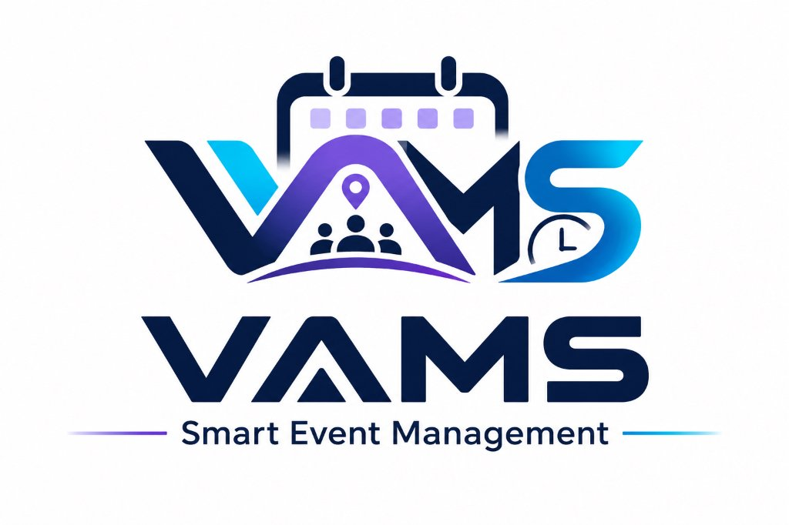

<p align="center">
  
</p>

<h1 align="center">🎓 VAMS — Smart Event Management Platform</h1>

<p align="center">
  <strong>Venue • Agenda • Management • Schedule & Seats</strong><br/>
  <em>A modern, enterprise-grade Event Management SaaS platform built strictly using modern <strong>HTML5, CSS3, and ES6+ Vanilla JavaScript</strong> with persistent client-side data architecture.</em>
</p>

<p align="center">
  <a href="https://developer.mozilla.org/en-US/docs/Web/HTML"></a>
  <a href="https://developer.mozilla.org/en-US/docs/Web/CSS"></a>
  <a href="https://developer.mozilla.org/en-US/docs/Web/JavaScript"></a>
  <a href="https://www.chartjs.org/"></a>
  <a href="LICENSE"></a>
</p>

## Live Demo

[Open VAMS on Vercel](https://webdev-project-aaing.vercel.app)

---

## 💎 What is VAMS?

**VAMS** is an all-in-one Event Management SaaS platform engineered to solve the complexities of campus festivals, tech symposiums, hackathons, and university operations:

| Pillar | Focus | Implementation & Capabilities |
| :---: | :--- | :--- |
| **V** | **Venue Coordination** | Centralized directory of auditoriums, computing centers, and seminar halls with real-time calendar availability matrices. |
| **A** | **Agenda & Timelines** | Multi-session scheduling engine equipped with an **automated JavaScript conflict detector** that flags overlapping speaker bookings and venue room collisions. |
| **M** | **Management Portal** | Complete organizer suite: dynamic event publishing wizard, sponsor tier tracking, student volunteer duty rosters, and financial budget engines. |
| **S** | **Schedule & Seats** | **Visual interactive SVG seating layout editor** with VIP, Premium, and General pricing tiers, automatic seat allocation, instant verified QR ticket pass generation, and turnstile check-in simulator. |

---

## 🎨 Enterprise Design System

The platform is styled strictly using clean CSS3 custom properties with zero external CSS frameworks (no Tailwind, no Bootstrap):

- **Primary Navy**: `#14213D`
- **Secondary Purple**: `#7357FF`
- **Accent Cyan**: `#00C2D7`
- **Background**: `#F7F8FC`
- **Surface**: `#FFFFFF`
- **Success / Warning / Danger**: `#16A34A` / `#F59E0B` / `#EF4444`
- **Typography**: Plus Jakarta Sans & JetBrains Mono
- **Themes**: Instant toggle between Light Mode and Dark Enterprise Theme

---

## 🌟 Modules & Features Overview

### 1. 🌐 Public Website (`#landing`)
- Modern navbar with quick role-switcher, theme toggle, and search trigger (`Ctrl + K`).
- High-converting hero section with category-filtered event search.
- Live category pills (Technical, Cultural, Workshop, Sports, Gaming) and real-time search.
- Event cards with capacity fill bars, pricing tags, and instant RSVP modals.
- How VAMS Works (4 Pillars breakdown).
- Campus venue highlights and transparent society pricing tiers.

### 2. 💺 Interactive Seating Management *(Standout Feature)*
- Visual SVG/DOM seating map with 6 tiered rows (A to F).
- Color-coded seats: VIP (Purple), Premium (Cyan), General (Blue), Booked (Gray), Selected (Green glow).
- Smart "Best Available" automatic seat allocation engine.
- Real-time seat reservation total calculation.

### 3. ⚠️ Agenda Conflict Detection Engine
- JavaScript conflict engine analyzes session timelines in real-time.
- Automatically flags:
  1. Keynote speaker double-booked across overlapping sessions.
  2. Room / Hall double-booked for two sessions at the same time.
  3. Session capacity exceeding venue limits.
  4. Invalid session timings (end before start or duration < 15 min).
- Provides actionable resolution recommendations.

### 4. 🎫 QR Ticket Passes & Gate Check-In Simulator
- Generates high-density QR codes for every attendee pass via `QRCode.js`.
- Clean printable badge styling with ticket ID (`TCK-XXXX`).
- Interactive turnstile camera scanner simulation with duplicate check-in prevention.

### 5. 💰 Financial & Budget Management
- Auto-calculates Estimated Budget vs Actual Expenses, Sponsorship Inflow, Ticket Sales, and Net Profit/Loss.
- Dynamic Chart.js expense distribution breakdown by department.

### 6. 📊 Analytics & Reports
- Registration velocity line chart and category market share doughnut chart.
- Single-click **Export to CSV** for attendees and analytics reports.

### 7. 🎓 Certificate Generator
- Official verified Certificate of Participation generator for any attendee and event with print capabilities.

### 8. 🔍 Global Search Command Palette (`Ctrl + K`)
- Instant keyboard-driven global search across events, venues, attendees, and settings.

---

## ⚡ Quickstart Guide

Launch the pure frontend SaaS platform with any static server or the bundled Vite server:

### Option A: Using NPM Dev Server
```bash
# 1. Clone repository
git clone https://github.com/vjkumar2756/WebDev-Project_iiit.git
cd WebDev-Project_iiit

# 2. Start dev server
npm run client
```
Access the application at: **`http://localhost:5173`**

### Option B: Using Python or Direct Browser Opening
```bash
# Simply open in browser or serve statically:
python3 -m http.server 8080 --directory client
```
Open **`http://localhost:8080`** in any modern web browser.

---

## 👥 Demo Role Profiles

Switch roles instantly from the topbar or settings panel:

| Role | Profile Name | Permissions & Scope |
| :--- | :--- | :--- |
| **Super Admin** | Dr. S. K. Mehta | Platform-wide overview, venue approvals, system reset |
| **Event Organizer** | Priya Verma | Event creation wizard, seating editor, timetable, budget |
| **Venue Manager** | Col. Rajesh Bakshi | Venue availability calendar matrix, facility management |
| **Event Staff** | Aditya Gupta | QR ticket turnstile scanner, gate check-in verification |
| **Student Attendee** | Rahul Sharma | Event exploration, seat booking, digital pass viewer |

---

## 📁 Clean Repository Structure

```
WebDev-Project_iiit/
├── vams-logo.png                  # VAMS Brand Logo
├── index.html                     # Root redirect entry point
├── client/
│   ├── index.html                 # Main Single-Page SaaS Application
│   ├── public/
│   │   └── vams-logo.png          # High-resolution Logo
│   ├── src/
│   │   ├── styles/
│   │   │   ├── variables.css      # CSS Design Tokens & Color Palettes
│   │   │   ├── main.css           # Core Resets, Buttons, Tables & Modals
│   │   │   ├── landing.css        # Public Website, Hero, Cards & Footer
│   │   │   └── dashboard.css      # SaaS Layout, Seating Editor & Matrix
│   │   └── js/
│   │       ├── store.js           # LocalStorage Data Engine & Demo Seed
│   │       ├── seating.js         # Interactive Visual Seating Map
│   │       ├── conflictDetector.js# Schedule Conflict Detection Engine
│   │       ├── qrTicket.js        # QRCode Pass Generator & Scanner
│   │       ├── charts.js          # Chart.js SaaS Visualizations
│   │       └── app.js             # Master App Controller & Router
│   └── package.json
└── README.md                      # Comprehensive Documentation
```

---

## 📜 Academic Integrity & License
Built for the **Web Development Laboratory Course (IIIT)**.  
Distributed under the **MIT License**.
